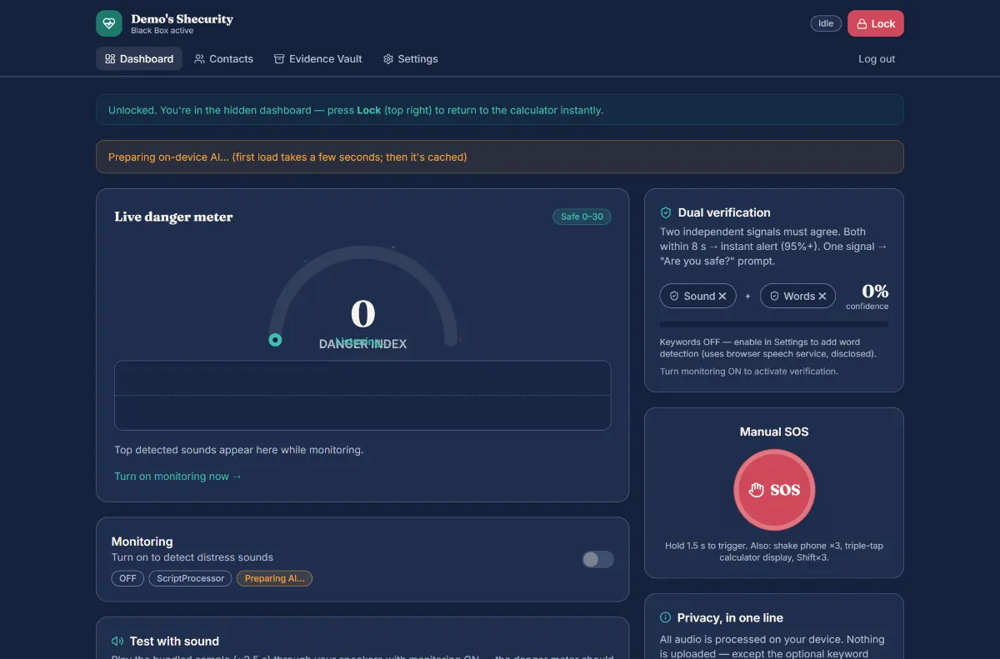
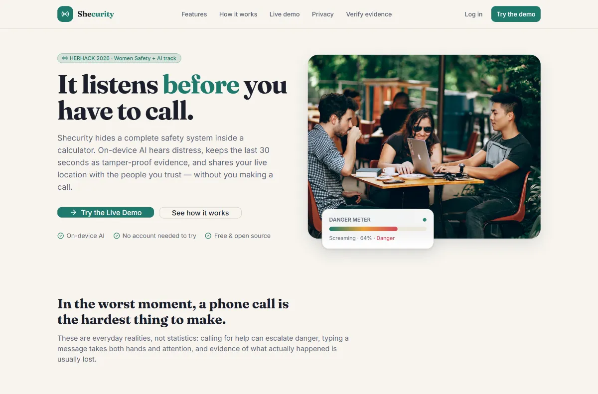
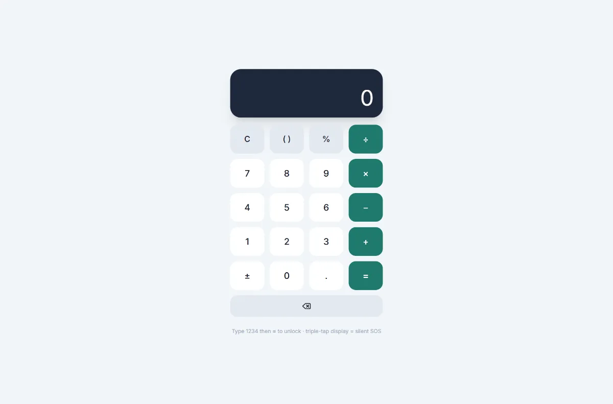
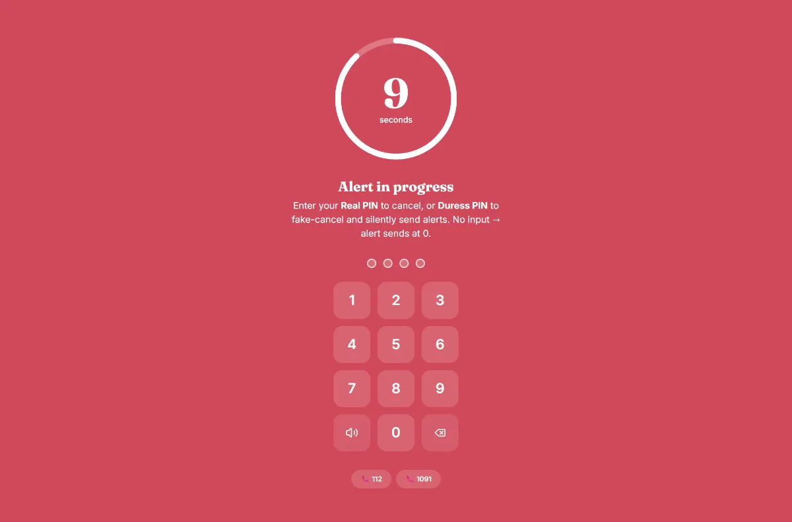
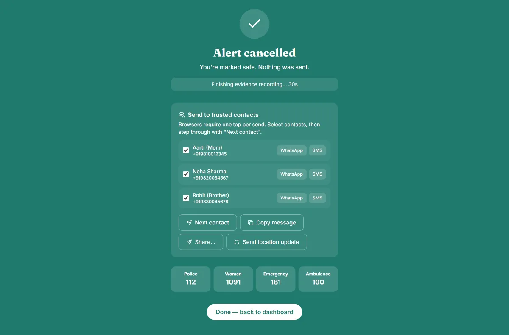
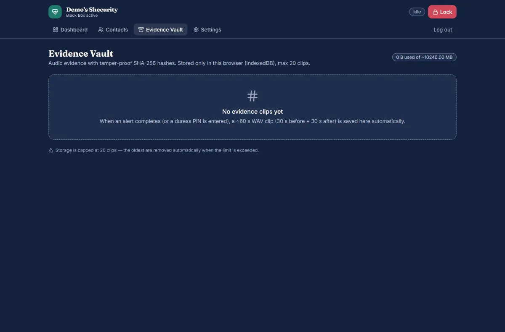
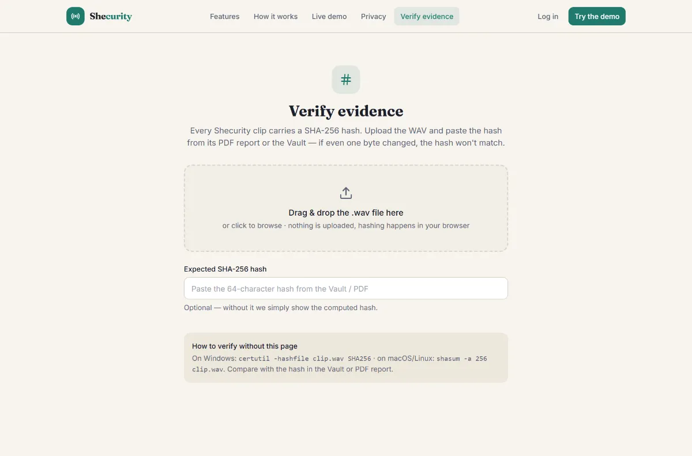
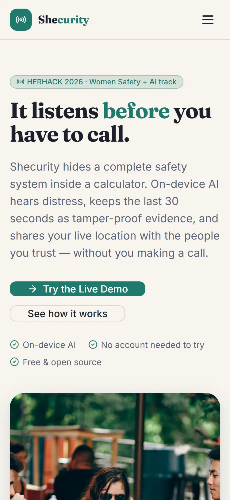
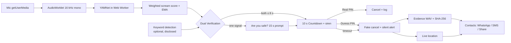

<div align="center">



# Shecurity

### It listens before you have to call.


[](https://shecurityapp.netlify.app/)


**[Live Demo](https://shecurityapp.netlify.app/)**

</div>

---

## 🚨 The Problem

In a real emergency there is no time — and often no safe way — to unlock a phone, find an app and press a button. Calling for help audibly can make a situation worse, typing a message takes both hands and attention, and afterwards there is usually no evidence of what actually happened. Existing SOS apps all require the one thing a person in danger may not have: a deliberate, visible action.

## 💡 Our Solution

**Shecurity** hides a complete safety system inside a calculator that looks and behaves like a normal app. Type your secret code and a hidden dashboard appears: on-device AI (YAMNet) listens for screams, a rolling 30-second black box keeps the audio from *before* any alert, and danger is confirmed through dual verification before anything happens. A duress PIN fakes a cancellation while silently alerting your trusted contacts with your live location, and every evidence clip is sealed with a SHA-256 hash you can verify publicly. Everything runs free, in the browser, with no paid API.

## ✨ Features

| Feature | What it does | Status |
|---|---|---|
| 🔢 Stealth Calculator | A real calculator (correct operator precedence, no `eval`) with a secret unlock code; wrong codes behave like normal math | ✅ |
| 🎙️ On-device Scream Detection | YAMNet (AudioSet) runs in a Web Worker via TensorFlow.js; audio is analyzed locally | ✅ |
| 📊 Live Danger Meter | Animated 0–100 gauge (Safe / Watch / Danger), real-time waveform, top-3 detected sounds | ✅ |
| 📼 Black Box Evidence | Rolling 30 s pre-roll + 30 s post-roll saved as a playable WAV when an alert fires | ✅ |
| 🔎 Dual Verification | Scream + keyword within 8 s → instant alert; a single signal shows a 15 s "Are you safe?" prompt first | ✅ |
| 🤐 Duress PIN | Fakes "Alert cancelled ✔" on screen while silently capturing evidence and sharing location | ✅ |
| 🔐 SHA-256 Evidence + PDF | Every clip is hashed (`crypto.subtle`) and exportable as a brand-colored PDF report | ✅ |
| 🌐 Public Verify Page | Anyone can upload a WAV + paste a hash at `/verify` — no login — and see Match / Tampered | ✅ |
| 📍 Live Location Sharing | High-accuracy GPS + per-contact WhatsApp / SMS / Copy / Web Share with prefilled emergency text | ✅ |
| 🆘 Multiple Triggers | SOS hold (1.5 s), shake-to-SOS, calculator triple-tap, Shift ×3 | ✅ |

## 🖼️ Screenshots

| | |
|---|---|
|  |  |
| *Landing page* | *The calculator disguise — no branding, neutral title* |
|  |  |
| *Hidden dashboard with the live danger meter* | *10-second countdown with PIN pad and siren* |
|  |  |
| *Silent alert cancelled screen with contact sharing* | *Evidence Vault — clips, hashes, PDF export* |
|  |  |
| *Public /verify page — Match / Tampered* | *Responsive at 375 px* |

## ⚙️ How It Works



## ⏱️ Judge Quick Demo (2 minutes)

The demo account is created on your device — nothing is sent anywhere.

**Demo credentials** (read from the demo account in `src/app/auth.ts` / `src/pages/Demo.tsx`): unlock code `1234=` · Real PIN `1234` · Duress PIN `9999`

1. Open **[shecurityapp.netlify.app](https://shecurityapp.netlify.app/)** → click **Continue as Demo User** (or *Live Demo* → *Open calculator*).
2. On the calculator, type **`1234`** then **`=`** → the hidden dashboard opens.
3. Flip **Monitoring** ON — "Preparing on-device AI…" appears once, then "YAMNet ready".
4. In **Test with sound**, press **Play scream sample** with your speakers on (no need to make noise yourself).
5. Watch the **danger meter** rise → the state text becomes "Possible distress".
6. The **10-second countdown** starts with siren and PIN pad.
7. Enter the **duress PIN `9999`** — the screen shows "Alert cancelled ✔"… but evidence and location were captured silently.
8. Open the **Evidence Vault** → a ~60 s clip (30 s pre-roll + 30 s post-roll) with its **SHA-256 hash**, timestamp and location.
9. Export the **PDF report**, then open **`/verify`**, drop the downloaded WAV and paste the hash → **Match**.
10. Back on the alert screen, use the **share panel** to send the live Maps link to a demo contact via WhatsApp/SMS (one tap per send — browser rule).

> 💡 The demo **Real PIN is `1234`** — use it during practice runs to genuinely cancel an alert.

## 🧰 Tech Stack

| Category | Technology |
|---|---|
| Frontend | React 18, TypeScript 5, Vite 5, Tailwind CSS 3, Framer Motion, React Router 6 |
| AI / ML | TensorFlow.js 4 · YAMNet (AudioSet, 521 classes) in a Web Worker |
| Audio | Web Audio API · AudioWorklet (ScriptProcessor fallback) · 16 kHz mono PCM · WAV encoder |
| Storage | IndexedDB (evidence clips) · localStorage (users/settings, PBKDF2-hashed secrets) |
| Maps | Leaflet + OpenStreetMap tiles (evidence mini-map) |
| Crypto | Web Crypto API — PBKDF2-SHA256 (150k iterations) · SHA-256 evidence hashing |
| PDF | jsPDF (evidence report generation) |
| Deploy | Netlify (static build, SPA redirects) |

## 🔒 Privacy & Honest Limitations

- 🎙️ **Scream detection is fully on-device** — audio never leaves the browser; clips are stored only in IndexedDB on your device.
- 🗣️ **Keyword detection is optional and off by default.** It uses the browser's speech service (in Chrome, audio is processed by Google's cloud). The disclosure is shown next to the toggle.
- 🔘 A web app **cannot detect the hardware power button** — the triple-press trigger needs the planned native app.
- 🌙 A web app **cannot listen with the screen off or the tab closed** — a Wake Lock keeps the screen on while monitoring.
- 📤 WhatsApp/SMS open **with a prefilled message and need one tap to send**. Nothing is ever sent automatically.
- 👤 **Demo accounts are stored only on your device** — passwords and PINs are PBKDF2-hashed with a random salt, never plain text.

## 🚀 Getting Started

**Prerequisites:** Node.js 18+

```bash
git clone https://github.com/raunakiitp/Shecurity.git
cd Shecurity
npm install

# one-time asset downloads (all free, no API keys):
npm run fetch-model    # YAMNet TFJS model → public/models/yamnet/
npm run fetch-assets   # photos + sample sound + PWA icons
npm run fetch-fonts    # Fraunces + Inter → public/fonts/

npm run dev            # http://localhost:5173
```

Production build & preview:

```bash
npm run build          # typecheck + production build → dist/
npm run preview        # serve dist/ locally
```

Quality checks:

```bash
npm run lint           # ESLint, zero warnings allowed
npm run typecheck      # tsc --noEmit
```

## ☁️ Deploy on Netlify

**Option A — drag & drop:** run `npm run build`, then drag the `dist/` folder onto [app.netlify.com/drop](https://app.netlify.com/drop).

**Option B — Git (recommended):**
1. Push this repo to GitHub.
2. Netlify → *Add new site* → *Import an existing project* → pick the repo.
3. Netlify reads `netlify.toml` automatically:
   - **Build command:** `npm run build`
   - **Publish directory:** `dist`

> 🔐 HTTPS is required for microphone and geolocation — Netlify provides it automatically (`localhost` is exempt for local development).

The live deployment is at **[shecurityapp.netlify.app](https://shecurityapp.netlify.app/)**.

## 📁 Project Structure

```
shecurity/
├── public/
│   ├── models/yamnet/     # YAMNet TFJS model (local, offline after fetch-model)
│   ├── images/            # WebP photos + CREDITS.md
│   ├── sounds/            # bundled sample + CREDITS.md
│   ├── fonts/             # self-hosted Fraunces + Inter
│   ├── audio-worklet.js   # 16 kHz mono capture processor
│   └── _redirects         # Netlify SPA fallback
├── src/
│   ├── app/               # router, ShecurityProvider (engines live above routing)
│   ├── pages/             # Landing, Calculator, Dashboard, Vault, Verify, …
│   ├── components/        # ui/ · layout/ · dashboard/
│   ├── engine/
│   │   ├── audio/         # capture, ring buffer, WAV encode
│   │   ├── detection/     # YAMNet worker, keywords, FSM
│   │   ├── alert/         # siren, vibration
│   │   ├── location/      # geolocation + share links
│   │   ├── crypto/        # PBKDF2 + SHA-256
│   │   └── storage/       # IndexedDB, localStorage, PDF
│   └── lib/               # shared types, constants, formatting
├── scripts/               # fetch-model / fetch-assets / fetch-fonts / verify-*
├── docs/screenshots/      # README imagery
└── netlify.toml
```

## 🗺️ Roadmap (future work)

- 📱 **Native Android app** — triple power-button press trigger and screen-off background listening
- 📨 **Automatic SMS** via a small backend (web apps cannot send SMS without a tap)
- 🤝 **Verified NGO / police integration** for direct escalation
- 🌍 **Multilingual keyword model** beyond Hindi/English (on-device)
- ⛓️ **Optional on-chain evidence timestamping** for independent proof-of-existence

## 👥 Team

Built by a 3-member team for HERHACK 2026.

| Name | Role | GitHub |
|---|---|---|
| Mahima Kumari | Frontend Developer: UI/UX, responsive design, marketing site | [@mahik2007](https://github.com/mahik2007) |
| Gyanvi | Research & Product Strategy: problem research, user insights, safety domain | [@gyanvisingh12745-gif](https://github.com/gyanvisingh12745-gif) |
| Raunak Yadav | Backend & Core Engine: audio pipeline, storage, cryptography, alert logic | [@raunakiitp](https://github.com/raunakiitp) |

## 🙏 Credits & License

- **YAMNet** model by Google Research (AudioSet) — Apache 2.0, loaded from [TFHub](https://tfhub.dev/google/tfjs-model/yamnet/tfjs/1)
- **TensorFlow.js** — Apache 2.0
- **Leaflet** (BSD-2) + **OpenStreetMap** map tiles (ODbL)
- **jsPDF** — MIT
- **Lucide** icons — ISC
- Photography — [public/images/CREDITS.md](public/images/CREDITS.md) (Unsplash License)
- Demo audio — [public/sounds/CREDITS.md](public/sounds/CREDITS.md) (synthesized in-repo, no restrictions)

Licensed under the [MIT License](LICENSE).

---

<div align="center">

**Built with ❤️ for HERHACK 2026 · IEEE EIT WIE · Echelon Institute of Technology**

</div>
